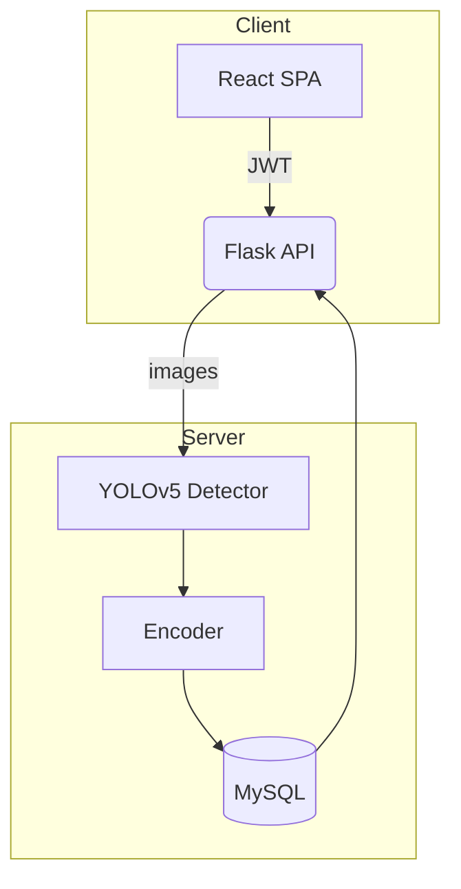

# Face‑Recognition Attendance System

> **BSc Computer Science Final‑Year Project (2024‑25)**  
> Real‑time, privacy‑aware student attendance tracking built with YOLOv5 + FaceNet, React, Flask & MySQL.

---

## Key Features

| Category | Highlights                                                                                 |
|----------|--------------------------------------------------------------------------------------------|
| **Computer Vision** | • YOLOv5 for fast face detection<br>• DLib embeddings for recognition           |
| **Full‑stack** | • React single‑page app UI<br>• Flask REST API <br>• MySQL relational store                |
| **Analytics** | • Live dashboard: attendance %, late arrivals, session heat‑map<br>• CSV export for admins |

---

## Architecture



---

## Quick Start (local dev)

### 1. Clone & configure
```bash
git clone https://github.com/your‑handle/face‑attendance.git
cd face‑attendance
```

### 2. Backend
```bash
python -m venv venv && source venv/bin/activate
pip install -r backend/requirements.txt
flask --app backend run
```

### 3. Frontend
```bash
cd frontend
npm install
npm run dev # localhost:3000
```

